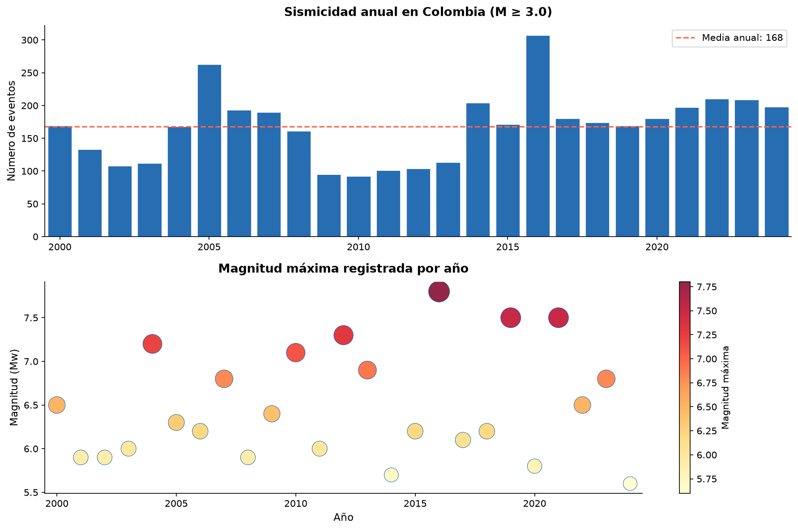
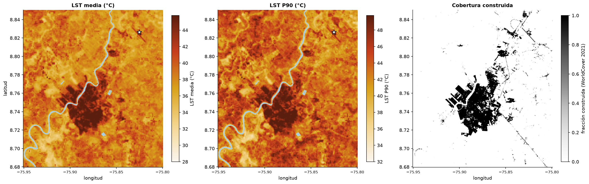

:::{div}
:class: coleccion-cabecera col-screen

# Cuadernos disponibles

Todos los cuadernos de la colección, del más reciente al más antiguo. Cada uno tiene su propio sitio, su repositorio en GitHub y su DOI en Zenodo, y puede ejecutarse en la nube sin instalar nada.
:::

::::::{div}
:class: coleccion-grid col-screen

:::::{card}
:url: https://scr-ungrd.github.io/cuadernos-reproducibles-crc003

{span .coleccion-meta}`CRC003 · Amenaza sísmica` {span .coleccion-fecha}`17 nov 2026`

**Análisis de sismicidad de Colombia**

Subdirección para el Conocimiento del Riesgo

Catálogo del USGS (2000–2026): magnitud de completitud, relación de Gutenberg-Richter, profundidad focal y mapas interactivos.

{span .coleccion-version}`v0.1.0 · DOI 10.5281/zenodo.24322598 · Sin validar`
:::::

:::::{card}
:url: https://scr-ungrd.github.io/cuadernos-reproducibles-crc002

{span .coleccion-meta}`CRC002 · Tsunami` {span .coleccion-fecha}`17 nov 2026`

**Simulación del Tsunami de Tumaco de 1979 con Google Colab**

Subdirección para el Conocimiento del Riesgo

Propagación del tsunami del 12 de diciembre de 1979 (Mw 8,3) con una fuente de Okada, contrastada con observaciones históricas.

{span .coleccion-version}`v2.2.2 · DOI 10.5281/zenodo.24324555 · Sin validar`
:::::

:::::{card}
:url: https://scr-ungrd.github.io/cuadernos-reproducibles-crc001

{span .coleccion-meta}`CRC001 · Calor urbano` {span .coleccion-fecha}`16 nov 2026`

**Riesgo por olas de calor urbano en Montería, Córdoba, bajo escenarios de cambio climático**

Subdirección para el Conocimiento del Riesgo

Proyección climática, olas de calor y riesgo relativo por calor urbano con tres escenarios del CMIP6, según el marco del IPCC AR6.

{span .coleccion-version}`v2.0.0 · DOI 10.5281/zenodo.24309440 · Sin validar`
:::::

::::::

:::{div}
:class: coleccion-pie col-screen

¿Quieres publicar un cuaderno? Consulta la [Guía para publicar](01-cuadernos-de-conocimiento.md) y la [Convocatoria](02-convocatoria-cuadernos.md).
:::
