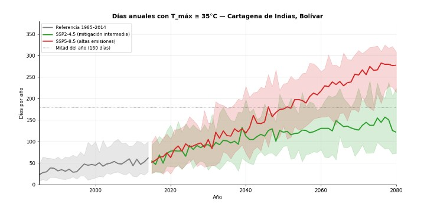
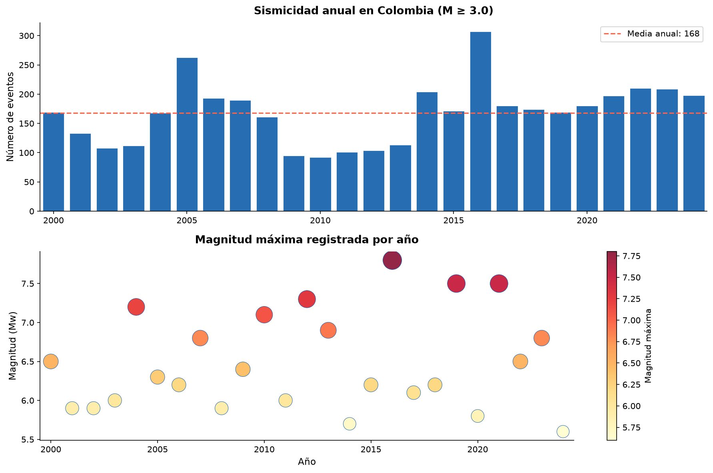
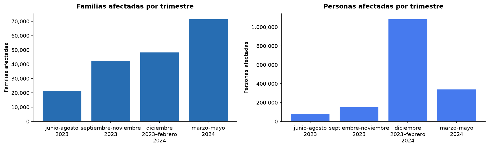
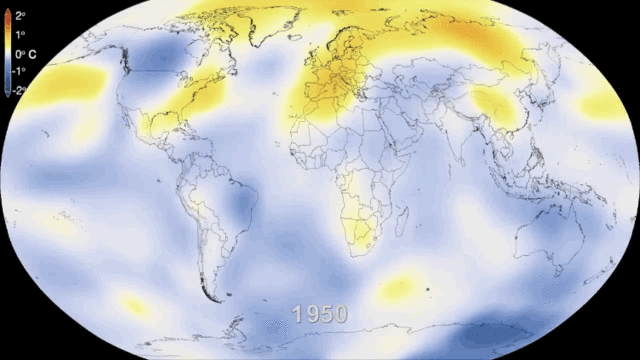
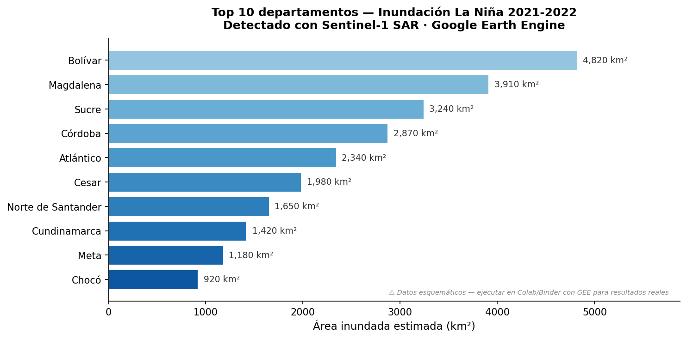

:::::{div}
:class: hero col-screen

```{image} ./images/hero-barranquilla-sentinel2.jpg
:alt: Imagen satelital Sentinel-2 de Barranquilla y la desembocadura del río Magdalena
:class: hero-bg
```

::::{div}
:class: hero-content

SUBDIRECCIÓN PARA EL CONOCIMIENTO DEL RIESGO · UNGRD

# Cuadernos Reproducibles

Publicamos cuadernos abiertos, ejecutables e interactivos que muestran cómo analizar las amenazas, la exposición y la vulnerabilidad en Colombia, con datos públicos, código y resultados que cualquiera puede reproducir.

{button}`Cuadernos recientes <#cuadernos>`
::::

::::{div}
:class: hero-credit

Imagen: Barranquilla y el río Magdalena, 31 de marzo de 2024. Contiene datos modificados de Copernicus Sentinel (2024), Unión Europea.
::::
:::::

:::{div}
:class: intro

**Cuadernos Reproducibles de Conocimiento del Riesgo de Desastres** es una colección en línea de la Unidad Nacional para la Gestión del Riesgo de Desastres (UNGRD). Cada cuaderno es **interactivo**: reúne el texto, el código y los resultados en un mismo documento que se puede ejecutar en la nube, sin instalar nada.

Cubre **cambio climático**, **olas de calor**, **sismos**, **tsunamis**, **inundaciones** y **fenómeno El Niño**, y está dirigida a equipos técnicos, autoridades territoriales, academia y quienes toman decisiones en **gestión del riesgo de desastres**. Todo se publica bajo principios de **ciencia abierta**.
:::

(cuadernos)=
## Cuadernos recientes

::::{card}
:url: https://scr-ungrd.github.io/cuadernos-reproducibles-crc002



**Riesgo por olas de calor urbano en Cartagena, Bolívar, bajo escenarios de cambio climático**

Cuaderno de la serie CRC-002. Riesgo por olas de calor urbano en Cartagena bajo escenarios de cambio climático, con datos de IDEAM, NEX-GDDP, Landsat y WorldPop en seis fases, según el marco del IPCC AR6.

Subdirección para el Conocimiento del Riesgo · 2 nov 2026
::::

::::{card}
:url: https://scr-ungrd.github.io/cuadernos-reproducibles-crc003


**Simulación del tsunami de Tumaco de 1979 (versión 2)**

Cuaderno de la serie CRC-003. Propagación del tsunami del 12 de diciembre de 1979 (Mw 8,3) en el Pacífico colombiano con una fuente de Okada y aguas someras lineales, ejecutable en Google Colab.

Subdirección para el Conocimiento del Riesgo · 2 nov 2026
::::

::::{card}
:url: https://scr-ungrd.github.io/cuadernos-reproducibles-crc004



**Análisis de sismicidad de Colombia**

Cuaderno de la serie CRC-004. Análisis exploratorio de la sismicidad colombiana con el catálogo del USGS 2000–2024. Incluye mapas interactivos, estadísticas por departamento y zonas de mayor actividad sísmica.

Subdirección para el Conocimiento del Riesgo · 30 jun 2026
::::

::::{card}
:url: https://scr-ungrd.github.io/cuadernos-reproducibles-crc006/



**Escenarios de riesgo ante el fenómeno El Niño 2026–2027**

Cuaderno de la serie CRC-006. Posibles escenarios de riesgo en Colombia ante un eventual fenómeno El Niño 2026–2027, basados en el análogo histórico 2023–2024. Incluye mapas interactivos, rankings departamentales y análisis temporal.

Christian Euscátegui y Moises Santizo · 21 may 2026
::::

::::{card}
:url: https://scr-ungrd.github.io/cuadernos-reproducibles-crc001



**Proyección de temperatura en Montería, Córdoba, bajo escenarios de cambio climático**

Cuaderno de la serie CRC-001. Escenarios de cambio climático en Montería hasta el año 2074, con análisis probabilístico en CLIMADA. Aporta evidencia para decidir medidas de reducción del riesgo por el aumento de la temperatura media anual.

Subdirección para el Conocimiento del Riesgo · 4 may 2026 · DOI 10.5281/zenodo.20061610
::::

::::{card}
:url: https://scr-ungrd.github.io/cuadernos-reproducibles-crc005



**Detección de inundaciones con Sentinel-1 SAR y Google Earth Engine**

Cuaderno de la serie CRC-005. Detección de inundaciones por La Niña 2021–2022 con imágenes SAR Sentinel-1 en Google Earth Engine. Analiza el cambio de retrodispersión y elabora cartografía por departamento.

Subdirección para el Conocimiento del Riesgo · 1 ene 2026
::::

:::{div}
:class: see-all

[Guía para publicar un cuaderno](01-cuadernos-de-conocimiento.md) · [Convocatoria](02-convocatoria-cuadernos.md)
:::
