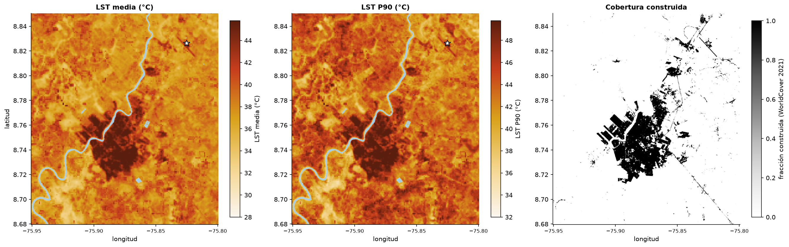
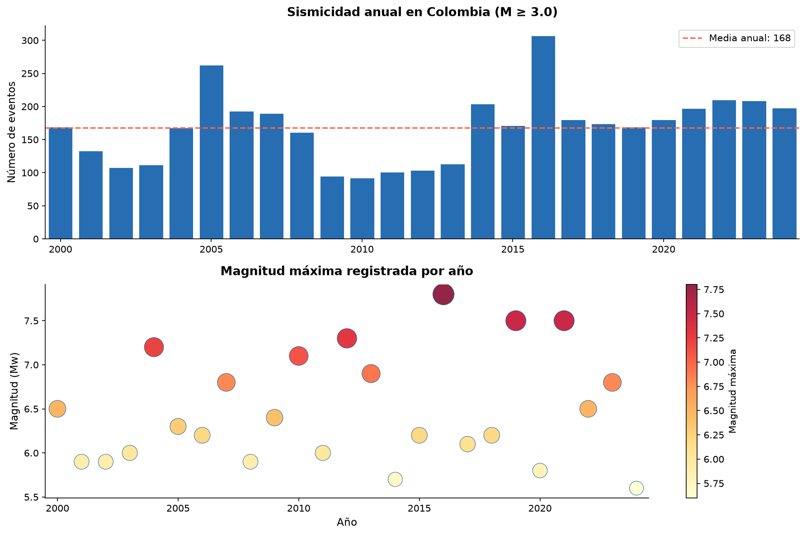

:::::{div}
:class: hero col-screen

```{image} ./images/hero-barranquilla-sentinel2.jpg
:alt: Imagen satelital Sentinel-2 de Barranquilla y la desembocadura del río Magdalena
:class: hero-bg
```

::::{div}
:class: hero-content

SUBDIRECCIÓN PARA EL CONOCIMIENTO DEL RIESGO · UNGRD

# Cuadernos Reproducibles de Conocimiento del Riesgo

Publicamos cuadernos abiertos, ejecutables e interactivos para realizar análisis en los tres procesos de la gestión del riesgo de desastres en Colombia: conocimiento del riesgo, reducción del riesgo y manejo de desastres. Promovemos el uso de datos públicos, flujos de trabajo con código y resultados que los usuarios puedan reproducir.

{button}`Cuadernos disponibles <cuadernos.md>`
::::

::::{div}
:class: hero-credit

Imagen: Barranquilla y el río Magdalena, 31 de marzo de 2024. Contiene datos modificados de Copernicus Sentinel (2024), Unión Europea.
::::
:::::

:::{warning} Proyecto en fase piloto
Este proyecto está en fase piloto. La convocatoria abrirá el 1 de marzo de 2027. El proyecto se presenta únicamente con fines de demostración y prueba, ya que los cuadernos no se han validado por expertos.
:::

:::{div}
:class: intro

**Cuadernos Reproducibles de Conocimiento del Riesgo de Desastres** es una colección de la Subdirección para el Conocimiento del Riesgo (SCR) de la Unidad Nacional para la Gestión del Riesgo de Desastres (UNGRD). Cada cuaderno es **interactivo**: contiene un marco teórico, código y resultados en un mismo documento, que puede ejecutarse localmente o en la nube.

Los cuadernos fomentan el uso, la reutilización y la promoción de herramientas de código abierto, como bienes públicos digitales, que aborden los tres procesos de la gestión del riesgo de desastres (GRD): conocimiento del riesgo, reducción del riesgo y manejo de desastres. Convocamos a presentar cuadernos a todos los actores del Sistema Nacional de Gestión del Riesgo de Desastres (SNGRD), incluidos investigadores, profesionales, estudiantes y actores comunitarios. Los cuadernos se dirigen a actores académicos, actores territoriales o municipales y a quienes toman decisiones en GRD y buscan replicar los cuadernos para resolver necesidades de conocimiento y problemas territoriales.

**La publicación científica y técnica cambió**. La publicación transitó del papel al PDF, y ahora avanza del PDF hacia documentos ejecutables e interactivos que integran texto, código y datos en un mismo objeto. Este modelo de publicación resuelve dos problemas centrales de los análisis de riesgo de desastres:

* **Falta de transparencia y reproducibilidad de los resultados**, que limita su uso para resolver problemas concretos en departamentos y municipios. Solo el 7,3 % de la producción científica en GRD en Colombia declara código abierto ([estado de la CTeI en gestión del riesgo de desastres en Colombia](https://scr-ungrd.github.io/estado-ctei-grd-colombia/)).
* **Desconexión entre el texto narrativo de un trabajo y el código, los datos y los parámetros** que soportan su metodología, sus resultados y sus conclusiones, lo que dificulta verificarlos y reutilizarlos ([Caprarelli et al., 2023](https://doi.org/10.1029/2023EA003458)).

**Esta colección no es una revista científica**. No se publican artículos de investigación originales. Los cuadernos reproducibles son un producto de **apropiación social del conocimiento**, en la modalidad de circulación de conocimiento especializado, porque ponen métodos y resultados de **productos ya publicados** al alcance de quienes los usan para decidir sobre el riesgo en el territorio (según la tipología de productos de ciencia, tecnología e innovación de Minciencias, 2024).

Sin embargo, los cuadernos tendrán un proceso de **revisión por pares** y deberán cumplir requisitos cuya verificación se agiliza con IA. Todo se publica bajo principios de **ciencia abierta**.

Los cuadernos también son un espacio de **transferencia de tecnologías**, así como de **divulgación y promoción científica**. Su código ejecutable los acerca también al software, aunque su propósito principal no es el desarrollo tecnológico, sino que el nuevo conocimiento se comprenda, se use y se apropie.

Nuestra visión es que cada cuaderno sea también un **agente de inteligencia artificial**. La IA ya cambia la forma en que se escribe, se lee y se reutiliza la ciencia, y cada vez más personas consultarán a un asistente antes que leer un documento completo. Un artículo y su código pueden convertirse en un agente que actúa como un «autor de correspondencia virtual» y expone sus funciones, datos y flujos de trabajo como herramientas mediante el Model Context Protocol (MCP). Un asistente invoca al agente para responder en lenguaje natural preguntas nuevas; por ejemplo, cómo cambia el riesgo en otro municipio o con otro escenario climático ([Miao et al., 2026](https://doi.org/10.1038/s41586-026-11044-y)). Esas herramientas se extraen de cuadernos ejecutados, como los de esta colección, y solo se aceptan si pruebas automáticas demuestran que reproducen los resultados y las figuras publicados.

En ese estudio, muchos repositorios no pudieron convertirse en agentes por código incompleto, documentación faltante o entornos imposibles de configurar. Por eso, Miao et al. (2026) proponen que la facilidad para convertir un trabajo en agente sirva como medida práctica de su reproducibilidad.

Así, la reproducibilidad que hoy exige la colección es la base del agente de mañana, y la interpretación de los resultados y las decisiones siguen a cargo de las personas.

:::

(cuadernos)=
## Cuadernos recientes

::::{card}
:url: https://scr-ungrd.github.io/cuadernos-reproducibles-crc001



**Riesgo por olas de calor urbano en Montería, Córdoba, bajo escenarios de cambio climático**

Proyección del cambio climático, olas de calor y riesgo relativo por calor urbano en Montería, en seis fases y con tres escenarios del CMIP6, según el marco del IPCC AR6. Usa datos abiertos de IDEAM, ERA5-Land, NEX-GDDP-CMIP6, Landsat, ESA WorldCover, WorldPop y OpenStreetMap. Incluye declaración de datos, uso de IA documentado y DOI en Zenodo. Ejercicio sin validar.

Subdirección para el Conocimiento del Riesgo · v2.0.0 · 16 nov 2026
::::

::::{card}
:url: https://scr-ungrd.github.io/cuadernos-reproducibles-crc002


**Simulación del Tsunami de Tumaco de 1979 con Google Colab**

Propagación del tsunami del 12 de diciembre de 1979 (Mw 8,3) en el Pacífico colombiano, con una fuente de Okada y aguas someras no lineales con fricción de Manning y celda seca (versión 3.0.0, en desarrollo; las ecuaciones lineales de la 2.2.2 se conservan como comparación), en tres cuadernos que corren en CPU. Contrasta la simulación con las observaciones de Herd et al. (1981) y de NOAA/NGDC, que no coinciden entre sí, e incluye ficha del modelo y límites explícitos. Ejercicio sin validar.

Subdirección para el Conocimiento del Riesgo · v2.2.2 (3.0.0 en desarrollo) · 17 nov 2026
::::

::::{card}
:url: https://scr-ungrd.github.io/cuadernos-reproducibles-crc003



**Análisis de sismicidad de Colombia**

Sismicidad de Colombia con el catálogo del USGS (2000–2026): magnitud de completitud, relación de Gutenberg-Richter por máxima verosimilitud (b = 1,22, valor corregido en la versión 0.1.1, en desarrollo; la 0.1.0 publicada daba 1,07), profundidad focal, cortes transversales, mapas interactivos y una ficha piloto de Córdoba. Describe amenaza, no riesgo. Incluye ficha del modelo. Ejercicio sin validar.

Subdirección para el Conocimiento del Riesgo · v0.1.0 (0.1.1 en desarrollo) · 17 nov 2026
::::


:::{div}
:class: see-all

**[Ver todos los cuadernos →](cuadernos.md)**

[Guía para publicar un cuaderno](01-cuadernos-de-conocimiento.md) · [Convocatoria](02-convocatoria-cuadernos.md) · [Requisitos para datos](03-estandar-de-datos.md) · [Requisitos para el uso de IA](05-uso-de-ia.md) · [Requisitos para tableros](06-estandar-tableros.md) · [Requisitos para aplicaciones](07-estandar-aplicaciones.md) · [Requisitos para modelos](08-estandar-modelos.md) · [Requisitos para el uso de LLMs](09-uso-de-llms.md) · [Requisitos de seguridad](10-requisitos-seguridad.md)
:::
